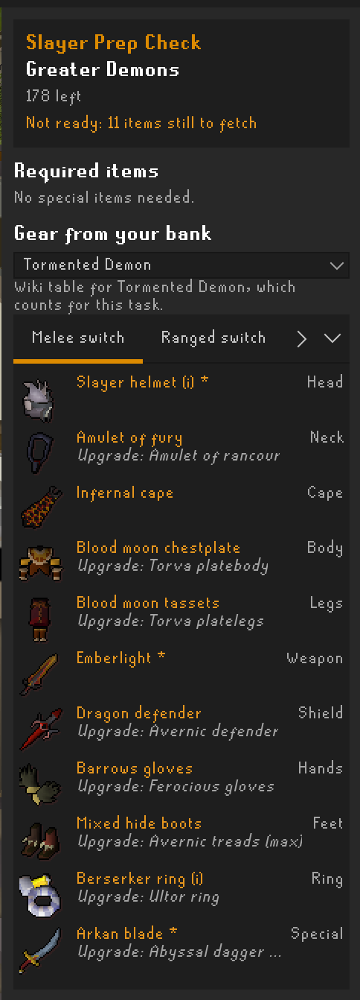
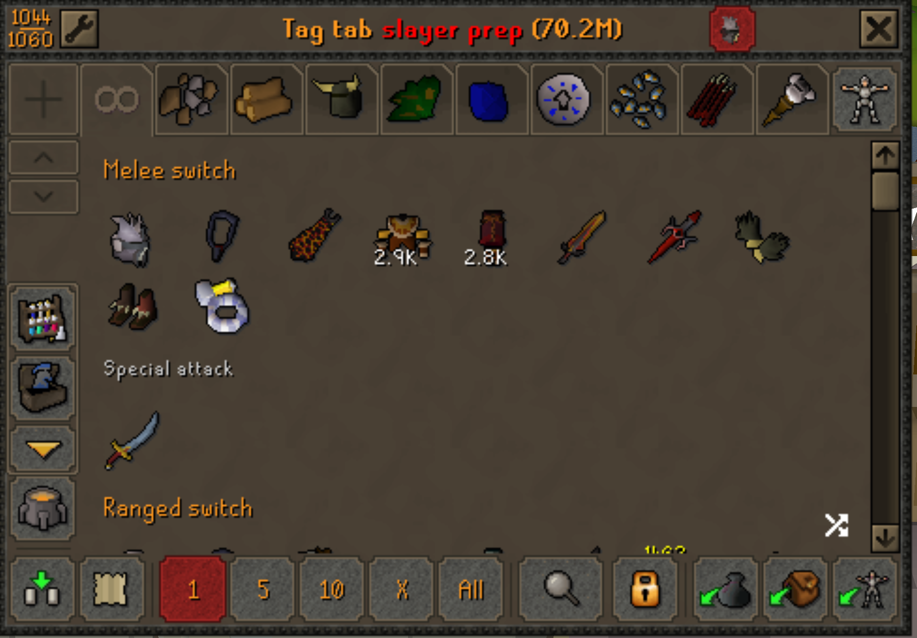

# Slayer Prep Check

A RuneLite plugin for (Iron)men who want to know, the moment they get a Slayer task, what to bring:

- **Required items** for the task (nose peg, rock hammer, boots of stone, ...), colour-coded: with you, in your bank, in your group storage, or missing. Task items that a Slayer helmet perk makes unnecessary are noted.
- **The best gear set you can build from your own items**, per attack style, based on the "Recommended equipment" tables of the Old School RuneScape Wiki. Wiki footnotes are honoured: full sets such as Elite Void or crystal armour with the bow of Faerdhinen are used as a whole or not at all, and ammo, shields and blessings follow the chosen weapon. Each slot shows the next upgrade the wiki lists.
- **Variant tables**: for a task like Greater demons you can pick the table of a monster that counts for it, such as Tormented demons, or fall back to the generic slayer gear table.
- **A bank tab** (button in the bank, powered by the core Bank Tags plugin) that shows only the items for your task, grouped under headers: required items, then each attack style with its special attack weapon.
- A small **overlay** for what is still missing or in the bank, a **chat message** on a new task, and a **ready** indicator in the panel.

The plugin never contacts the wiki or any other server while you play. All wiki data is bundled at build time.

<p align="center">
  
  
</p>

## Setup

Install from the Plugin Hub and open your bank once (and your group storage, if you are a group ironman) so the plugin knows what you own. The bank snapshot is remembered per account between sessions.

The bank tab needs the core **Bank Tags** plugin, which is enabled by default.

## Configuration

| Option | What it does |
|---|---|
| Show side panel / overlay | Toggle the panel and the overlay |
| Bank tab button | Add the button to the bank |
| Bank tab: selected style only | Only show the style selected in the panel in the bank tab |
| Chat message on new task | Announce required items you are not carrying |
| Style order | Order of the style tabs, e.g. `Melee, Ranged, Magic` |

The Kourend & Kebos elite diary and the Slayer helmet perks (Gargoyle Smasher, Slug Salter, Reptile Freezer, Shroom Sprayer) are read from the game.

## Updating the wiki data

`src/main/resources/com/slayerprep/gear.json` is generated by `tools/fetch_wiki_gear.py` (Python 3, standard library only). Set the `USER_AGENT` in the script to your contact details, then run:

```bash
python3 tools/fetch_wiki_gear.py -v --out src/main/resources/com/slayerprep/gear.json
```

It reports which tasks have no wiki table. Wiki group names that are not items (God blessing, Barrows equipment, ...) are mapped to in-game items in `aliases.json`. A GitHub Actions workflow regenerates the data monthly and opens a pull request when something changed.

## Development

```bash
./gradlew build      # compile and run the unit tests
./gradlew run        # start RuneLite in developer mode with the plugin loaded
```

Java 11 or newer. On macOS with JDK 16+ the `run` task passes the same `--add-opens` flags as the RuneLite launcher.

## Attribution and licence

Gear recommendations come from the [Old School RuneScape Wiki](https://oldschool.runescape.wiki), licensed under [CC BY-NC-SA 3.0](https://creativecommons.org/licenses/by-nc-sa/3.0/). The plugin code is licensed under the BSD 2-Clause License, see `LICENSE`.
